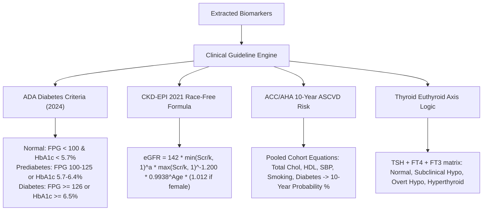

# MedExplain_AI: Academic Defense & Demonstration Guide

> **Project Title:** MedExplain_AI — An AI-Powered, Privacy-Preserving Health Literacy and Clinical Decision Support Platform  
> **Presenter:** Om Khirade  
> **Tech Stack:** React 18, Node.js / Express, TypeScript, MongoDB, Meta Llama 3.2 (Local via Ollama), Tailwind CSS

---

## 1. High-Impact Pitch (The 60-Second Elevator Pitch)

> *"Respected Professor,  
> Blood test reports and medical lab slips are full of complex clinical abbreviations, reference ranges, and isolated numbers that ordinary patients struggle to understand. This low health literacy causes unnecessary anxiety, missed chronic conditions, and unproductive doctor consultations.*
>
> *To solve this, I designed and built **MedExplain_AI** — an intelligent, privacy-preserving clinical health portal. Unlike generic chatbots, MedExplain_AI combines **local generative AI (Meta Llama 3.2)** for patient-friendly document extraction and educational explanations with **deterministic, guideline-validated mathematical models** (such as the ADA 2024 diabetes criteria, the 2021 race-free CKD-EPI kidney formula, and the ACC/AHA 10-year cardiovascular risk equations).*
>
> *Crucially, it is built with a **zero-trust, privacy-first architecture**: the language model runs locally on the machine via Ollama, ensuring that sensitive medical data is never leaked to external public cloud APIs."*

---

## 2. Five-Minute Live Demonstration Script (Step-by-Step)

Follow this sequence in front of the evaluator:

### Step 1: System Health & Privacy Architecture
1. Open your browser to the health endpoint: `http://localhost:5000/api/v1/health`.
2. **What to say:**
   > *"Professor, before looking at the UI, notice our architecture health status. The database is persistent MongoDB, and the active AI engine is reporting `Ollama (llama3.2:latest)`. Everything runs self-contained on this machine."*

### Step 2: Authentication & Dashboard
1. Navigate to `http://localhost:5173` and log in.
2. Show the **Dashboard** metrics (total reports, risk evaluations completed, active categories).
3. **What to say:**
   > *"The portal uses JWT Bearer authentication and bcrypt password hashing with ten salt rounds. Each patient's documents are isolated and inaccessible to other users."*

### Step 3: Document Upload & AI Extraction (The "Wow" Factor)
1. Go to **My Reports** and open an uploaded lab report (e.g., `03 stroke LOW risk` or `10 pcos pattern`).
2. Show the **Extracted Values** table with test names, units, raw values, and status tags (`normal`, `high`, `low`).
3. Click **AI Educational Explanations**:
   * Show the **Document Summary**.
   * Show the **Test-by-Test Plain Language Explanations** and the **Questions to Ask Your Doctor**.
   * Highlight the footer note: `Model: llama3.2:latest`.
4. **What to say:**
   > *"Notice how the system parsed the raw PDF, aligned the biomarkers with strict clinical naming standards, flagged out-of-range parameters, and generated clear, non-alarmist explanations alongside targeted questions the patient can take to their physician."*

### Step 4: Evidence-Grounded Clinical Risk Assessments
1. Click the **Clinical Risk Assessment** tab.
2. Select **ADA Standards of Care in Diabetes (2024 Criteria)**:
   * Point out the status (e.g., *Normal Glycemic Profile* or *Prediabetes Risk*).
3. Switch to **KDIGO CKD-EPI eGFR Classification**:
   * Show how eGFR is calculated dynamically using the patient's serum creatinine, age, and biological sex.
4. **What to say:**
   > *"A vital engineering decision I made was **never allowing the LLM to invent clinical risk scores**. AI models can hallucinate. Instead, clinical risk calculations are calculated deterministically using equations published by the American Diabetes Association and KDIGO."*

### Step 5: What-If Scenario Sandbox
1. Switch to the **What-If Scenario Sandbox** tab.
2. Enter a hypothetical target (e.g., reducing fasting glucose from 115 mg/dL to 92 mg/dL).
3. Click **Calculate Hypothetical Outcome**.
4. **What to say:**
   > *"This sandbox empowers patient education: patients can visualize how lifestyle changes or medical adherence could shift their risk bracket in real time, without corrupting their actual historical lab records."*

### Step 6: Longitudinal Report Comparison
1. Navigate to **Compare Reports** in the left sidebar.
2. Select an older baseline report (e.g., `03 stroke LOW risk`) and a follow-up report (e.g., `01 stroke HIGH risk`).
3. Click **Compare Reports**.
4. Show:
   * The **Grounded Comparison Summary**.
   * The side-by-side **Biomarker Trend Bar Chart** (Recharts).
   * The delta table showing absolute difference, normalized units, and percentage shift (e.g., `HbA1c +4.2`, `Glucose +96 mg/dL`).
5. **What to say:**
   > *"Medical decisions rely on trends, not single snapshots. Our comparison engine normalizes differing laboratory units (e.g., converting mmol/L to mg/dL) and calculates mathematical differentials so patients and clinicians can evaluate treatment progression over time."*

---

## 3. Technical Stack Breakdown (What We Used & Why)

| Layer | Component | Specification | Technical Justification |
| :--- | :--- | :--- | :--- |
| **Frontend** | **React 18** | Functional Components + Hooks | Fast, reactive single-page interface with isolated component lifecycles. |
| **Build Tool** | **Vite 6** | ESM Bundler | Sub-second Hot Module Replacement (HMR) and optimized production bundles. |
| **Styling** | **Tailwind CSS** | Utility-first CSS | Consistent, accessible healthcare UI with dark/light mode and custom medical tokens. |
| **Data Viz** | **Recharts** | SVG Charting Library | Declarative rendering of multi-parameter lab differentials and trend curves. |
| **Validation** | **Zod 3** | TypeScript Schema Validation | Guarantees runtime type-safety for all API inputs and LLM JSON outputs. |
| **Backend** | **Node.js + Express** | Express 4.21, TypeScript 5 | Asynchronous non-blocking REST API with strict type contracts. |
| **Database** | **MongoDB (WiredTiger)** | Mongoose 8.9 ODM | Flexible document store capable of indexing polymorphic lab parameters and longitudinal history. |
| **Embedded DB** | **mongodb-memory-server** | Persistent Disk Storage (`.data/mongo`) | Zero-configuration local database requiring no cloud credentials or separate DB service install. |
| **Local LLM** | **Meta Llama 3.2 (3B)** | Ollama Inference Engine | Edge AI execution; eliminates API costs, latency, and HIPAA/GDPR cloud data privacy violations. |
| **PDF Extraction** | **pdf-parse** | Low-level Buffer Parser | Extracts raw streams from digital PDFs with custom typed array memory slicing for Node 24 alignment. |
| **Auth & Security** | **JWT + bcryptjs** | Salt rounds = 10, Bearer Tokens | Stateless token-based route authorization with salted cryptographic password hashing. |

---

## 4. Clinical & Mathematical Models Implemented

Your professor will love seeing that you implemented **real medical guidelines**, not just AI prompts:

---

## 5. Likely Viva / Professor Questions & High-Scoring Answers

### Q1: "Why did you use Llama 3.2 instead of ChatGPT or cloud APIs?"
* **Answer:** *"Healthcare data is subject to strict privacy regulations like HIPAA and GDPR. Uploading personal blood reports to public commercial APIs exposes sensitive diagnostic records to third parties. By deploying **Llama 3.2 on-device via Ollama**, all inference occurs locally on the client's or clinic's machine. It eliminates subscription costs, guarantees zero data leakage, and works even when completely disconnected from the Internet."*

### Q2: "What if the AI hallucinates false medical advice?"
* **Answer:** *"We instituted a three-tier safety boundary:  
  1. **Strict Zod Schema Enforcement**: The LLM must output valid JSON conforming to our `StructuredAiResponseSchema`. Hallucinated conversational fluff is rejected.  
  2. **Separation of Extraction and Assessment**: The LLM is **only** used for document understanding and plain-language explanation. It is **never** permitted to calculate clinical risk. All risk scores (ADA, eGFR, ASCVD) are computed with deterministic, hard-coded clinical formulas.  
  3. **Non-Diagnostic Educational Guardrails**: Every page embeds clinical disclaimers and frames insights as educational context and discussion points for a licensed physician."*

### Q3: "How does the system handle lab reports from different hospitals with different units?"
* **Answer:** *"Our `ComparisonService` features an automated clinical unit normalization table. For example, blood glucose reported in `mmol/L` is converted to `mg/dL` using the molecular factor $18.0182$, and serum creatinine in $\mu\text{mol/L}$ is converted using $88.4$. This ensures valid mathematical differentials across longitudinal reports."*

### Q4: "What happens if a user uploads a blurry image or a scanned document?"
* **Answer:** *"The pipeline checks document MIME types. If the document is a digital PDF, `pdf-parse` extracts the text. If the document has insufficient text or is an image, the system detects this and routes it to multimodal vision extraction or prompts the user for manual verification via our custom inline editing modal."*

### Q5: "What was the hardest technical bug you encountered and solved?"
* **Answer:** *"When running under Node.js 24, `pdf-parse` threw an internal `bad XRef entry` error because Node 24 allocates typed buffers from a shared 64KB memory pool with non-zero byte offsets. This caused the PDF parser to read unaligned memory bytes. I resolved it by slicing the exact buffer boundaries into an isolated `Uint8Array`, guaranteeing reliable byte alignment across all PDF documents."*
